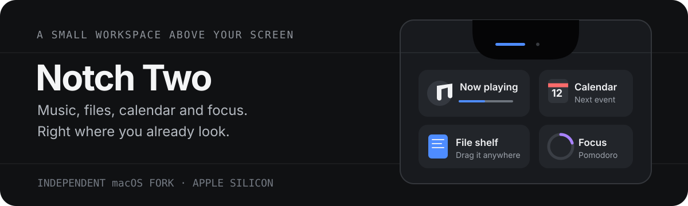

<p align="center">
  <a href="README.ru.md">Читать по-русски</a>
</p>

<p align="center">
  
</p>

# Notch Two

Notch Two puts music, your calendar, and a drag-and-drop file shelf in the MacBook notch. Hover over the notch to open the panel.

**[Download for Apple Silicon](https://github.com/kkonstantin08/notch-two/releases/download/v0.1.0-preview.4/Notch-Two-2.8-beta.0-build.275-arm64.zip)** · [Release notes and SHA-256](https://github.com/kkonstantin08/notch-two/releases/tag/v0.1.0-preview.4)

## What you can do

- **Music and calendar.** Control playback and check upcoming events from the notch.
- **File shelf.** Drop files onto the shelf and drag them out when you need them.
- **Notifications.** Show macOS notifications in the notch. A Telegram card can open its original chat while the notification action is available.
- **Timers and network.** Enable Pomodoro, wellness reminders, or the network indicator in **Settings → Custom Features**. The network indicator shows Wi-Fi changes and when the system network route drops or returns. Showing the Wi-Fi name requires Location permission.

Choose English, Russian, German, Spanish, French, or the macOS default in **Settings → General → Language**. Restart Notch Two to apply the change.

## Get the preview

The current preview is **v0.1.0-preview.4** (app version `2.8-beta.0`, build `275`). It requires an Apple Silicon Mac running macOS 15.6 or later.

1. Download and expand the ZIP above.
2. Move **Notch Two.app** to **Applications**, then open it.
3. If macOS blocks the preview, verify its SHA-256 against the release and clear the quarantine flag before opening it again. The app is ad-hoc signed and has no Apple notarization.

   ```sh
   xattr -dr com.apple.quarantine "/Applications/Notch Two.app"
   ```

## Build from source

Use an Apple Silicon Mac with macOS 15.6 or later and Xcode 26 or later.

```sh
git clone https://github.com/kkonstantin08/notch-two.git
cd notch-two
./scripts/test.sh
./scripts/build.sh
open ".build/xcode/Build/Products/Release/Notch Two.app"
```

## Upstream and license

Notch Two is an independent fork of [Boring Notch](https://github.com/TheBoredTeam/boring.notch), based on [`0477a9b`](https://github.com/TheBoredTeam/boring.notch/tree/0477a9be8c8f4c426749f8fd2d5334e04851067a). It has its own bundle identifier, XPC helper, and data container. Run one notch app at a time.

Distributed under [GPL-3.0](LICENSE). See [third-party licenses](THIRD_PARTY_LICENSES) and the [upstream change history](UPSTREAM.md).
