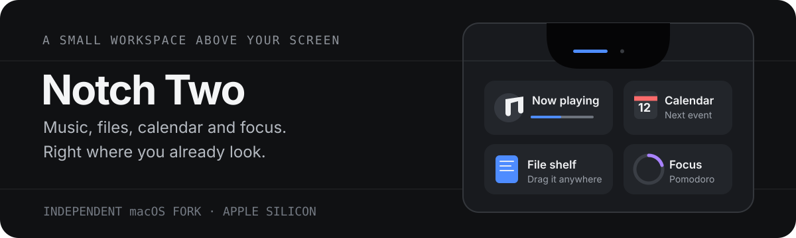

<p align="center">
  <a href="README.md">Read in English</a>
</p>

<p align="center">
  
</p>

# Notch Two

Notch Two добавляет плеер, календарь и полку для файлов в вырез экрана MacBook. Наведите курсор на вырез, чтобы открыть панель.

**[Скачать для Apple Silicon](https://github.com/kkonstantin08/notch-two/releases/download/v0.1.0-preview.4/Notch-Two-2.8-beta.0-build.275-arm64.zip)** · [Описание релиза и SHA-256](https://github.com/kkonstantin08/notch-two/releases/tag/v0.1.0-preview.4)

## Возможности

- **Музыка и календарь.** Управляйте воспроизведением и смотрите ближайшие события прямо в панели.
- **Полка для файлов.** Перетащите файлы на полку и заберите их оттуда, когда они понадобятся.
- **Уведомления.** Смотрите уведомления macOS в вырезе. Нажмите на карточку Telegram, чтобы открыть чат. Это работает, пока macOS может открыть исходное уведомление.
- **Таймеры и сеть.** Включите Помодоро, напоминания о перерывах для глаз или индикатор сети в разделе **Настройки → Дополнительные функции**. Индикатор показывает смену Wi-Fi, потерю и восстановление сетевого маршрута. Для отображения имени Wi-Fi нужен доступ к геопозиции.

В разделе **Настройки → Основные → Язык** доступны английский, русский, немецкий, испанский, французский и вариант «Как в системе». Чтобы применить выбор, перезапустите Notch Two.

## Установка превью

Текущая версия — **v0.1.0-preview.4** (версия приложения `2.8-beta.0`, сборка `275`). Нужен Mac с Apple Silicon и macOS 15.6 или новее.

1. Скачайте и распакуйте ZIP по ссылке выше.
2. Перенесите **Notch Two.app** в папку **Программы** и откройте приложение.
3. Если macOS блокирует запуск, сверьте контрольную сумму SHA-256 архива с опубликованной и снимите атрибут карантина. Сборка использует подпись ad-hoc и не прошла нотариализацию Apple.

   ```sh
   xattr -dr com.apple.quarantine "/Applications/Notch Two.app"
   ```

## Сборка из исходников

Для сборки нужен Mac с Apple Silicon, macOS 15.6 или новее и Xcode 26 или новее.

```sh
git clone https://github.com/kkonstantin08/notch-two.git
cd notch-two
./scripts/test.sh
./scripts/build.sh
open ".build/xcode/Build/Products/Release/Notch Two.app"
```

## Исходный проект и лицензия

Notch Two — независимый форк [Boring Notch](https://github.com/TheBoredTeam/boring.notch) на базе [`0477a9b`](https://github.com/TheBoredTeam/boring.notch/tree/0477a9be8c8f4c426749f8fd2d5334e04851067a). У него свои идентификатор приложения, служба XPC и контейнер данных. Запускайте только одно приложение для выреза одновременно.

Код распространяется под лицензией [GPL-3.0](LICENSE). См. также [лицензии зависимостей](THIRD_PARTY_LICENSES) и [историю изменений относительно исходного проекта](UPSTREAM.md).
